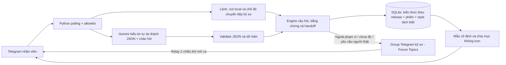

# Kiến trúc MVP Telegram nội bộ

Cập nhật theo yêu cầu đã trao đổi, thay phương án web/Next.js ban đầu. Hiện có công cụ dữ liệu; chưa có bot runtime.

## Luồng đề xuất



## Lựa chọn cho giai đoạn đầu

- Python 3.11+; máy hiện có 3.12. SQLite đi kèm, không cần DB server.
- Một tiến trình long polling, không webhook/domain/Docker. Gemini chạy qua API, không tải model vào máy.
- Telegram và Gemini là adapter; core logic không phụ thuộc kênh để thêm Messenger sau.
- Không cần vector DB/RAG tổng quát cho 5 hồ sơ. Query theo khóa, fact và quan hệ ứng viên có thể kiểm tra được.
- Cấu hình model, token, timeouts, `ENGINEER_GROUP_CHAT_ID`, giờ trực và section policy nằm ngoài code nghiệp vụ; secrets trong `.env` cục bộ.
- **Tách rạch ròi kho học giao tiếp khỏi kho kiến thức kỹ thuật:** lịch sử hội thoại ngắn hạn (3–6 lượt cùng phiên) và kho ví dụ chào hỏi/từ đồng nghĩa (`communication_examples`, `utterance_aliases`) chỉ phục vụ tối ưu giao tiếp và trích xuất ý định, không bao giờ chỉnh sửa đáp án sâu bệnh.

## Cấu trúc dự kiến khi build

```text
src/eco_bot/
  config.py
  adapters/telegram.py
  adapters/gemini.py
  domain/diagnostics.py
  domain/conversation.py
  domain/handoff.py           # đóng gói tóm tắt ca, ticket, relay 2 chiều với kỹ sư
  knowledge/repository.py
  knowledge/importer.py
  learning/style_optimizer.py # tổng hợp ví dụ giao tiếp/từ đồng nghĩa offline + guardrail tự động
  rendering/messages.py
  storage/migrations/
tests/
data/cleaned/              # staging đã xuất, có thể tái tạo
data/runtime/              # runtime tương lai, tách khỏi staging
```

Chưa tạo package này. Chi tiết schema ở `data-model.md`, kế hoạch ở `../03-san-pham/ke-hoach-chatbot-telegram.md`.

## Nguyên tắc

Không thêm cổng duyệt trước trả lời theo yêu cầu chủ dự án. Phạm vi trả lời là 5 ID đã chọn, dữ liệu nguồn và trạng thái gốc được bảo toàn. Kiểm tra kỹ thuật/schema tự động vẫn cần để không thực thi nhánh mâu thuẫn. Gemini chỉ hiểu hội thoại, không có quyền chọn ID ngoài phạm vi hoặc viết lại lời khuyên kỹ thuật. Unknown không phải No; một ứng viên còn lại không đủ chứng minh đúng nếu nguyên nhân thật ngoài pilot.

Sessions cô lập, update chống lặp, timeout/fallback rõ, câu chào không phá ngữ cảnh. Khi phiên chuyển sang chế độ `HUMAN_HANDOFF`, tắt engine chẩn đoán tự động cho phiên đó để không chen ngang cuộc trao đổi giữa người dùng và kỹ sư; chỉ báo đã chuyển kỹ sư sau khi Telegram API xác nhận gửi thành công. Chỉ gửi thật khi người dùng yêu cầu chạy bot và cấu hình credential. Long polling trên Windows dừng khi máy ngủ/tắt hoặc tiến trình dừng.
